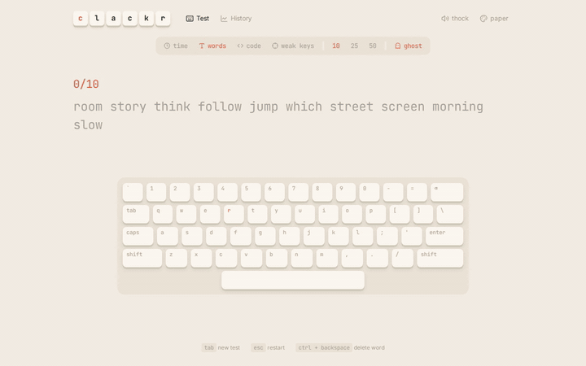

# Clackr

A typing test that shows you where you're slow, not just how fast you are. It draws your speed every second, lights up the keys you miss on a keyboard heatmap, and builds practice tests from your weakest keys.

**Live:** https://rimjhimyadav.github.io/clackr/

<p align="center">
  
</p>

## Features

- **4 modes**: time (15 / 30 / 60s), words (10 / 25 / 50), code (real JavaScript snippets) and weak keys
- **Ghost race**: a faded caret replays your personal best for the same test, and shows how far ahead or behind you are as you type
- **Live keyboard** on screen that presses with yours and shows the next key
- **Results**: wpm, accuracy, raw speed, consistency and a speed chart with every mistake marked
- **Key heatmap** of the letters you miss most, for one test and for all your tests
- **Weak keys practice** that makes a test from words with the keys you keep missing
- **Mechanical keyboard sounds** made in the browser with the Web Audio API: "thock" (deep, like linear switches) and "clicky" (like blue switches)
- **History** with personal bests and your last 30 tests on a chart
- 5 color themes, saved in your browser
- Shortcuts: `Tab` for new words, `Esc` to restart with the same words, `Ctrl + Backspace` to delete a word

## Built with

- React 19 + TypeScript + Vite
- Zustand
- React Router
- Tailwind CSS v4
- Vitest for tests
- GitHub Actions to lint, test, build and deploy to GitHub Pages

## Run it locally

```bash
npm install
npm run dev
```

- `npm test` runs the tests for the typing and stats logic
- `npm run lint` runs ESLint
- `npm run build` type-checks and builds
